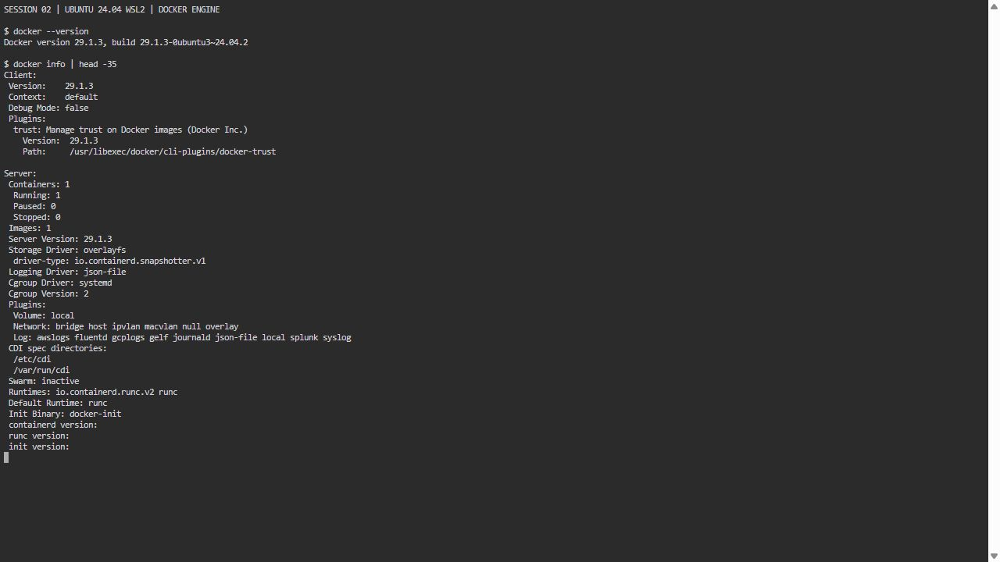
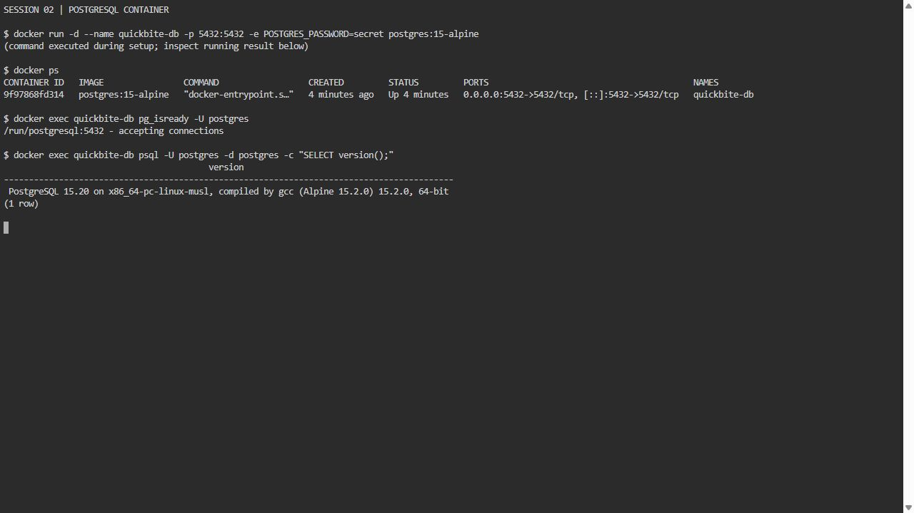
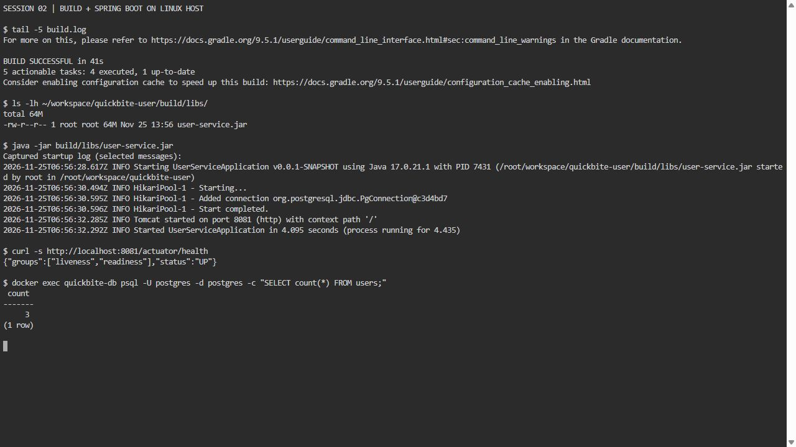

# Báo cáo thực hành Session 02 — Giới thiệu Docker

Ngày thực hiện: 25/11/2026.

## 1. Mục tiêu và môi trường

Cài Docker Engine trên Linux, chạy PostgreSQL trong container, build QuickBite User Service và chạy JAR trực tiếp trên Linux host để kiểm tra kết nối database.

Môi trường thực hành: Ubuntu 24.04 trên WSL2, Docker Engine 29.1.3, OpenJDK 17, Gradle Wrapper 9.5.1. Docker Engine được cài riêng trong Ubuntu bằng `apt`, không dùng Docker Desktop Engine cho bài thực hành. Các lệnh Linux được thực hiện với tài khoản root; vì vậy có thể bỏ `sudo`.

## 2. Nhiệm vụ 1 — Cài đặt và xác thực Docker Engine

Chuẩn bị Ubuntu từ PowerShell trên Windows:

```powershell
wsl --install Ubuntu-24.04 --no-launch --web-download
wsl -d Ubuntu-24.04 -u root
```

Trong Ubuntu:

```bash
export DEBIAN_FRONTEND=noninteractive
apt-get update
apt-get install -y docker.io openjdk-17-jdk-headless git curl sudo
systemctl start docker
docker --version
docker info
java -version
```

Kết quả: Docker version 29.1.3; Docker Server hoạt động trên Ubuntu, OSType linux, kiến trúc x86_64. Log đầy đủ: [docker-info.log](logs/docker-info.log). Ảnh chỉ hiển thị 35 dòng đầu của `docker info` để đọc được trong một màn hình.



## 3. Nhiệm vụ 2 — Chạy PostgreSQL bằng Docker

```bash
docker run -d --name quickbite-db \
  -p 5432:5432 \
  -e POSTGRES_PASSWORD=secret \
  postgres:15-alpine

docker ps
docker exec quickbite-db pg_isready -U postgres
docker exec quickbite-db psql -U postgres -d postgres -c 'SELECT version();'
```

Kết quả: container `quickbite-db` ở trạng thái `Up`, image `postgres:15-alpine`, port mapping `5432:5432`. `pg_isready` xác nhận `accepting connections`. Database mặc định là `postgres`, username `postgres`, password `secret`, đúng cấu hình đề bài. Mật khẩu này chỉ dùng cho bài thực hành local.



## 4. Nhiệm vụ 3 — Tải mã nguồn và build JAR

```bash
mkdir -p ~/workspace
cd ~/workspace
git clone https://github.com/backend-fullskill-devops/quickbite-user
cd quickbite-user
chmod +x gradlew
./gradlew clean bootJar --console=plain
ls -lh build/libs/
git rev-parse HEAD
```

Mã nguồn: https://github.com/backend-fullskill-devops/quickbite-user

Commit thực hành: `2493915bb6df92d2064705c6cbae7a0ea515b970`.

Kết quả thực tế: `BUILD SUCCESSFUL in 41s`, tạo file `build/libs/user-service.jar` khoảng 64 MB. Có cảnh báo Gradle deprecated features, nhưng build hoàn tất thành công. Không sửa mã nguồn hoặc phiên bản dependency. Bài yêu cầu `bootJar`, nên không chạy bộ test riêng.

Log đầy đủ: [build.log](logs/build.log).

## 5. Nhiệm vụ 4 — Chạy ứng dụng trên Linux host

Dự án dùng `application.yml`. Ghi đè datasource qua biến môi trường chuẩn của Spring Boot để giữ nguyên mã nguồn:

```bash
cd ~/workspace/quickbite-user
export SPRING_DATASOURCE_URL=jdbc:postgresql://localhost:5432/postgres
export SPRING_DATASOURCE_USERNAME=postgres
export SPRING_DATASOURCE_PASSWORD=secret
java -jar build/libs/user-service.jar
```

Trong lần thực hành, tiến trình được giữ chạy nền để thu thập minh chứng:

```bash
nohup java -jar build/libs/user-service.jar > application.log 2>&1 < /dev/null &
echo $! > application.pid
```

Kiểm tra từ terminal khác:

```bash
curl -s http://localhost:8081/actuator/health
docker exec quickbite-db psql -U postgres -d postgres -c 'SELECT count(*) FROM users;'
```

Kết quả: HikariCP ghi nhận thêm kết nối `org.postgresql.jdbc.PgConnection` và `HikariPool-1 - Start completed.`; Spring Boot khởi động thành công ở cổng 8081. Health endpoint trả về `{"groups":["liveness","readiness"],"status":"UP"}`. Truy vấn bảng `users` thành công, xác nhận schema đã được ứng dụng tạo trong PostgreSQL. Có cảnh báo SpringDoc mặc định bật API docs, không phải lỗi kết nối database.

JAR chạy bằng tiến trình Java trên Ubuntu host; chỉ PostgreSQL chạy bên trong container. Kết nối qua `localhost:5432`, đúng yêu cầu port mapping.



Log đầy đủ: [application.log](logs/application.log). Ảnh terminal hiển thị các message khởi động trích từ log JSON để đọc rõ; log gốc được giữ nguyên trong thư mục `logs/`.

## 6. Thu thập minh chứng

Ảnh được chụp từ terminal Linux thực tế hiển thị qua `ttyd` ở chế độ chỉ đọc. Các kết quả Docker/SQL/health được chạy trực tiếp lúc chụp; phần build và startup được đọc từ log của lần chạy thật.

```bash
apt-get install -y ttyd
docker info > docker-info.log
docker ps > docker-ps.log
tail -5 build.log
```

Các script terminal và lệnh hỗ trợ chụp ảnh được đính kèm trong thư mục `evidence-scripts/`. Đường dẫn log trên Windows trong lần chạy là `D:\rikkei-session02\`; đường dẫn tương ứng trong WSL là `/mnt/d/rikkei-session02/`.

## 7. Kết luận

Đã cài và xác thực Docker Engine trên Linux; khởi chạy PostgreSQL đúng tên, image và cổng; build JAR thành công; chạy Spring Boot trực tiếp trên Linux host và kết nối được database trong container. Bằng chứng thực thi và ảnh đính kèm đáp ứng bốn nhiệm vụ của bài thực hành.

Để dừng sau khi kiểm tra:

```bash
# Thay <PID> bằng PID Java đã lưu trong application.pid.
kill <PID>
docker stop quickbite-db
```
